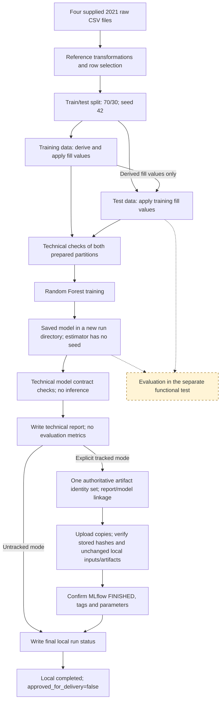
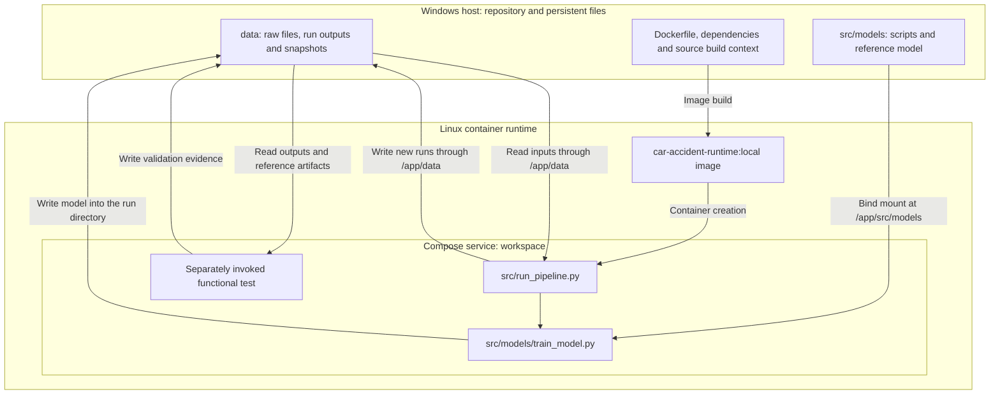
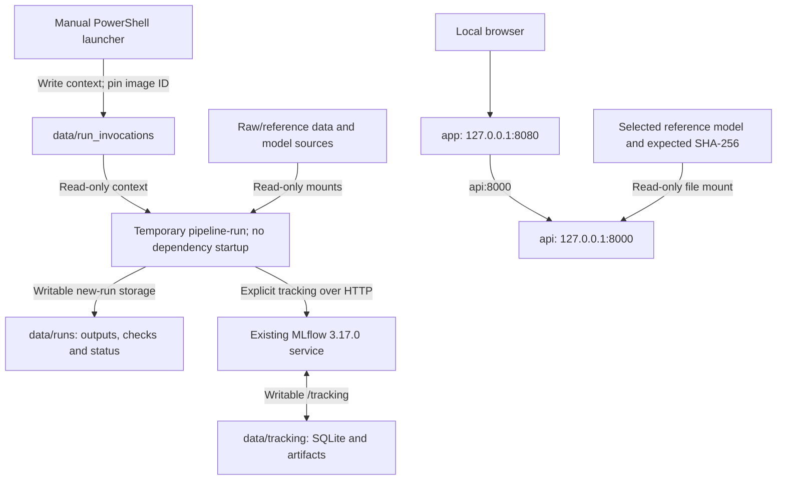
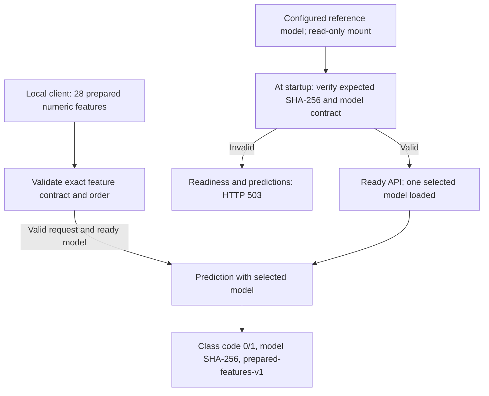
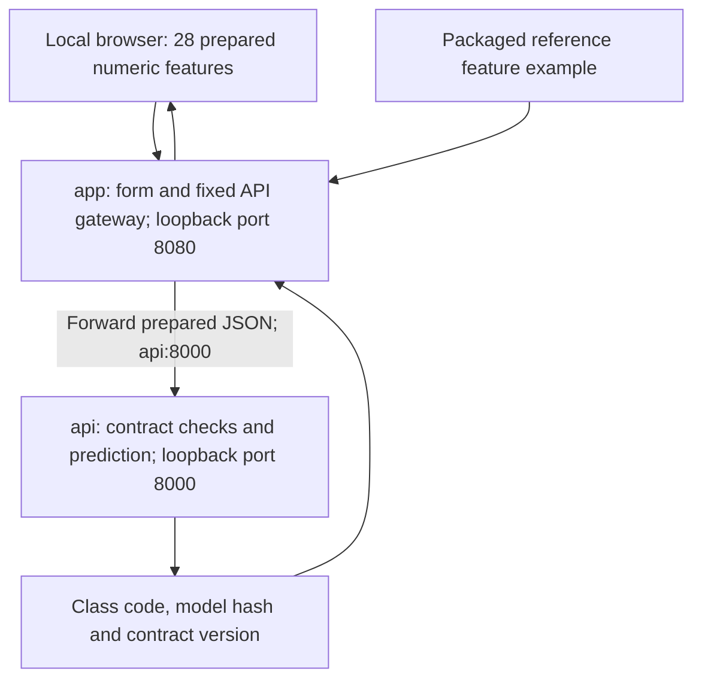
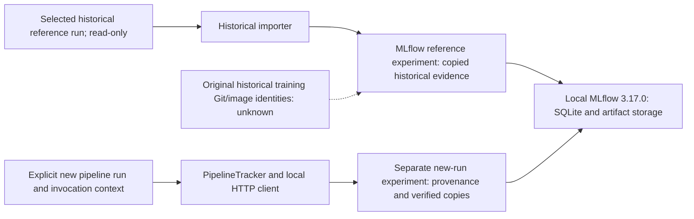
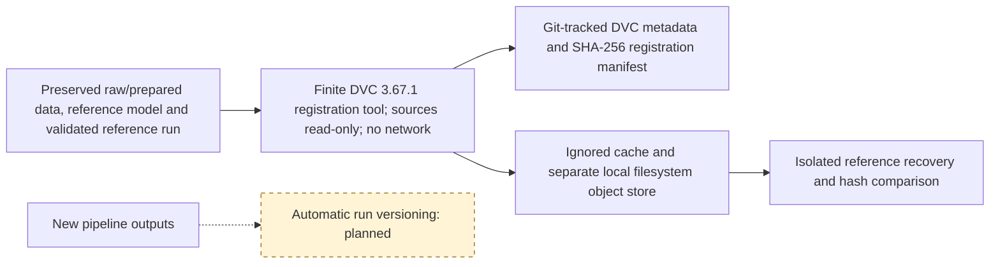
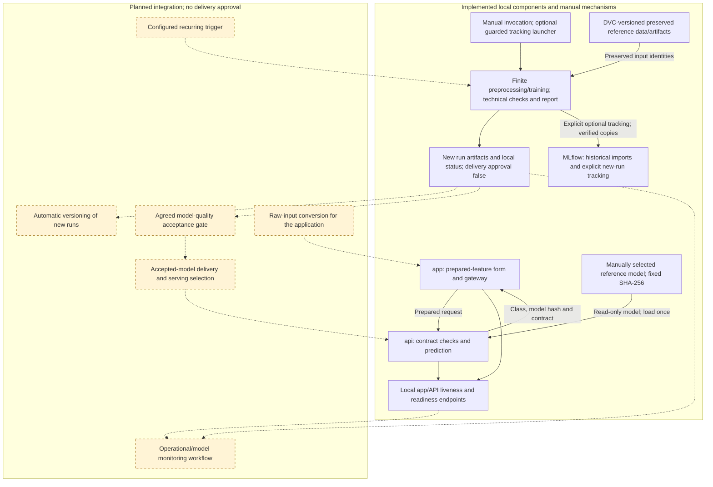

# Architecture

Project: car_accident  
Status: NON_FINAL  
Document date: 2026-10-11
Architecture source review: 2026-10-11; implementation and configured boundaries, not a new runtime validation
Implementation evidence: local build and functional validation on 2026-10-03

## Scope and evidence

The project operationalises the supplied 2021 road-accident data,
preprocessing and Random Forest reference model. It is an educational
demonstration, not a validated operational police system.

Docker and Docker Compose are required. Level 1 is mandatory;
Level 2 is a separately tracked extension.

The diagrams distinguish implemented behaviour from the proposed target.
They do not establish deployment approval or a live infrastructure inventory.

Functional validation evidence:
`data/runs/validation_20261003T193310Z_56c49087/validation_report.json`

That report binds the tested source files, raw data and trained model to
SHA-256 hashes and records model metrics. It does not yet provide a complete
link between Git revision, container image identity and model delivery.

## 1. Implemented data flow

This diagram shows implemented code paths. Any technical, tracking, artifact or
final-status writing failure prevents successful completion and returns exit 1.
Failure handling preserves the primary error and partial artifacts, attempts to
record failure, and retains unknown remote outcomes without automatic retry.
The separate evaluation procedure does not determine technical pipeline status.

- Merging, feature calculations, fixed recoding and selected row filtering
  happen before the split.
- The split uses `test_size=0.3` and `random_state=42`.
- After the split, missing values in `surf`, `circ`, `col` and `motor`
  are filled using modes derived from the training data.
- Training preserves `RandomForestClassifier(n_jobs=-1)`, without a seed.
  Repeated fits can produce different models and predictions.
- Before training, both prepared feature/target pairs must be non-empty with
  matching row counts, the existing 28 ordered features, finite numeric feature
  values and target codes limited to 0 and 1.
- After training, the newly produced artifact must be a Random Forest with the
  established feature contract and model classes `[0, 1]`. These checks perform
  no inference, scoring or holdout evaluation.
- A new technical report records check results, run identity, model SHA-256 and
  UTC verification timestamps. Report writing must succeed before the run is
  marked `completed`; this does not establish model quality or delivery approval.
- Evaluation currently belongs to the separate functional test.
  It is not an automatic pipeline acceptance or delivery gate.
- Explicit tracked runs additionally require recorded provenance and verified
  artifact copies in the existing local MLflow server before local completion.

Technical pipeline validation addition: 2026-10-10. The October 3 functional
report predates this addition and remains unchanged. Targeted test-double checks
do not establish a new real-data training or evaluation result. The existing
separate evaluation procedure is not invoked or imported by the pipeline.

## 2. Implemented runtime boundaries

The evidenced environment uses Windows, WSL2 and Linux containers.
The base `compose.yaml` defines `workspace`. Pipeline commands run in temporary
containers created from that service. The API and application overlays add
separate persistent services, described in sections 3 and 4. The tracking
overlay adds the isolated service described in section 5. A separate finite
versioning tool is described in section 6.

The base workspace diagram above is separate from the overlay boundaries below.
Historical import and finite DVC tooling have their own diagrams in sections 5
and 6; they do not automatically run alongside the pipeline.

These are configured runtime boundaries, not a current service inventory.
Published endpoints bind only to Windows loopback: app `8080`, API `8000`, and
MLflow `5000`. The base workspace retains its two writable mounts. The pipeline
launcher requires the existing tracking service and starts no dependencies.

The image contains `src/run_pipeline.py` and `src/data` source files.
Changes to these files require rebuilding the image.

The optional `pipeline-run` service builds a separate pipeline image from that
Dockerfile. Its PowerShell launcher records Git/configuration/source observations
and pins the actual image ID for one finite invocation. It starts no dependencies.
Only new-run storage is writable; raw/reference data and model sources are read-only.
The existing workspace command remains available without tracking.

The host directory `src/models` is mounted over the corresponding image
directory. Executed model scripts can therefore differ from the image
contents. The completed functional test compared all three affected
source files with their host hashes.

Both existing bind mounts are writable. The pipeline protects outputs
through new run directories and exclusive file creation; the mounts
themselves do not enforce read-only protection.

### Storage contract

| Location | Purpose |
| --- | --- |
| `data/raw/` | Existing supplied raw CSV files |
| `data/runs/<run_id>/preprocessed/` | Four processed datasets for a new run |
| `data/runs/<run_id>/model/trained_model.joblib` | Newly trained model |
| `data/runs/<run_id>/run_status.json` | Run state and failure information |
| `data/runs/<run_id>/validation_report.json` | Technical checks, run/model identities and UTC verification times; no evaluation metrics |
| `data/preprocessed/` | Preserved reference datasets |
| `src/models/trained_model.joblib` | Preserved reference model |
| `data/reference_snapshots/20261003T182822Z_3490e1df/` | Preserved reference snapshot |

The pipeline rejects an existing run directory and returns a nonzero exit
code on failure. Failures after run-directory creation are recorded in the
run status when storage remains writable. Failures during initial input
checks occur before a run directory is created.

A completed training run has `approved_for_delivery=false`. Completion requires
the existing stages, technical data/model checks and technical report writing.
Evaluation results do not determine that status. A technical failure uses the
existing failed-status and nonzero-exit handling and preserves produced files.
Tracked mode also requires confirmed artifact/metadata recording. Its new
`tracking_evidence/` files bind invocation and MLflow IDs to the executed sources,
actual inputs, configuration, environment, technical report and produced model.

## 3. Local prepared-feature API

Implementation addition: 2026-10-06. Runtime validation must be established
from the installation output, not from the presence of these files.

`compose.api.yaml` adds `api` while keeping `workspace` unchanged. Its image
extends the existing local runtime image. The selected model file is mounted
read-only, and Windows exposes only `127.0.0.1:8000`. The service consumes
prepared features. Raw-input conversion remains separate; the prepared-feature
application is described in section 4.

The service loads the selected artifact once and checks its ordered feature
names, feature count, estimator type and class codes. It neither retrains nor
changes historical delivery approval. Full input rules, artifact identity,
health endpoints, commands and limitations are in [api-contract.md](api-contract.md).
The following target diagram includes this local API; automated delivery and
its acceptance gate are still planned.

## 4. Local prepared-feature application

Implementation addition: 2026-10-07. Establish Windows runtime validation
from the installation output; these files alone do not establish a running app.

`compose.app.yaml` adds `app` and leaves the existing API and workspace files
unchanged. The app image extends the validated local API image and adds no
runtime dependencies. Windows exposes only `127.0.0.1:8080`. The app has no
model, data or repository bind mounts and forwards requests to `api:8000`.

The form can load the preserved reference example. Blank fields are required;
no values or category labels are inferred. Input edits clear the old result,
and the gateway preserves JSON bytes for the API's validation. The interface
displays class codes without unconfirmed severity labels. See
[local-app.md](local-app.md) for use, endpoints, commands and verification scope.

The app's readiness endpoint checks API readiness. This does not constitute
quality approval or continuous monitoring. Raw-input conversion and suitability
for decisions before intervention remain open.

## 5. Local historical reference tracking

Implementation addition: 2026-10-08. Establish Docker/Windows validation from
successful installation output; source presence alone does not establish it.

`compose.tracking.yaml` adds `mlflow` and a temporary `tracking-import` tool.
The isolated tracking image pins MLflow 3.17.0. Windows publishes only
`127.0.0.1:5000`. The server persists SQLite metadata and artifact copies in
`data/tracking/`; the tool reads the selected October 3 reference directory
through a read-only mount and transfers files through the artifact proxy.

The first run imports the unchanged validation report, run status and selected
model bytes. It retains original timestamps, observed metrics, class-code
mapping and `approved_for_delivery=false`. The original training Git revision
and image identity remain unknown. Import Git baseline, dirty worktree state,
image identity, importer hash and time are recorded separately.

A sequential repeat verifies the same finished run and its artifact hashes.
The historical importer does not instrument subsequent pipeline runs, register
a model version, change the API model, enforce acceptance thresholds or retrain. Detailed storage,
provenance, commands and test scope are in [tracking.md](tracking.md).

Implementation addition: 2026-10-10. The explicit new-run tracking mode uses a
separate `car_accident_reference_pipeline` experiment. Lifecycle tags and
exclusively created provenance/artifact manifests bind new training observations
to verified artifact copies. Existing DVC input metadata is referenced only when
the actual input hashes match; new outputs are not automatically DVC-versioned.
Tracking errors fail the local run and attempt remote failure marking. Uncertain
remote outcomes remain explicit; no automatic replay or atomic cross-store
transaction is claimed. Targeted doubles establish only their own test scope.
The opaque HTTP case requires an already running server; its current execution
evidence and limitations are documented in [tracking.md](tracking.md).
Neither case establishes a real-data training result or model quality.

Import observations do not replace unknown original training identities. Neither
tracking path changes the selected serving model or automatically registers or
approves a model version.

## 6. Local reference artifact versioning

Implementation addition: 2026-10-08. Establish Windows/Docker validation from
successful installation output. Source presence does not establish recovery.

The separate `compose.versioning.yaml` defines a finite DVC 3.67.1 tool; it
has no published port or runtime network. It does not extend training, serving
or tracking images. Its source-data mounts are read-only. Five metadata files
under `versioning/` refer to the four supplied raw CSVs, original prepared data,
separate preserved model, validated reference run and validation report.

DVC stores content in its ignored cache and a separate local filesystem store.
The tool sets `DVC_SITE_CACHE_DIR=/tmp/dvc-site-cache` for temporary internal
state on the writable `/tmp` mount. This is separate from the persistent content
cache and object store. The October 9 diagnosis observed the default internal
path `/var/tmp/dvc` on a read-only filesystem during an incomplete initialisation.
The guarded repair preserves that partial state and requires successful local
output before recovery is considered validated.

Git versions small metadata files and the SHA-256 registration manifest. An
isolated recovery begins with an empty cache and checks all 16 recovered files
against the original SHA-256 observations. Original file hashes are checked again.

Registration baseline HEAD and versioning image identity describe this new step;
they do not identify the original training revision or training image. Historical
`approved_for_delivery=false` is preserved. The original model and selected
serving model retain separate identities. See [versioning.md](versioning.md).

The MLflow database, snapshots, backups and assets are outside this registration.
Future automatic versioning of new training runs, external CI access and
protection against local drive loss remain separate work.

This diagram describes the reference-versioning mechanism. It does not establish
a new recovery result, external storage, or versioning of subsequent run outputs.

## 7. Target architecture and remaining work

This diagram distinguishes current implementations from planned integration.
Solid boxes are implemented components or current manual mechanisms; amber
dashed boxes and dashed links denote planned work. This source-based distinction
does not prove current service readiness. Logical layers do not imply one
microservice for every pipeline stage.

### Service responsibilities and transition

| Component | Responsibility and lifecycle |
| --- | --- |
| `workspace` | Current development and test environment; may remain optional after responsibilities are covered |
| `pipeline-run` | Implemented manual finite job for preprocessing/training and optional tracking; configured triggering remains planned |
| `api` | Implemented local prepared-feature service with an explicit model hash |
| `app` | Separate local prepared-feature form and gateway to the API |
| `mlflow` and storage | Historical imports and explicit new pipeline-run metadata with verified artifact copies |
| Monitoring | Track failures, service health and agreed data/model indicators |

The local API, prepared-feature application, historical reference tracking
and reference artifact versioning have separate implementations. Explicit
new-run tracking is available; automatic run versioning, configured triggers and controlled delivery
remain subsequent work. A complete raw-input application remains separate.

MLflow is selected for local tracking. DVC is selected for local reference
artifact versioning; neither step alone completes the automated Level 1 workflow.

The prepared-feature contract is specified in `docs/api-contract.md`. Mapping
raw application inputs to the model's 28 ordered features remains separate;
the supplied example does not establish a complete raw-input serving pipeline.

## 8. Limitations and open decisions

- The inherited successive target recodings map original codes
  `[1, 2, 3, 4]` to `[1, 1, 1, 0]`. Domain labels remain unconfirmed.
- Selection of one road-user row per accident depends on observed severity.
  This limits claims about prediction before intervention.
- The measured model metrics are reference observations, not agreed
  quality thresholds. Agree thresholds before enforcing model acceptance.
- No configured recurring trigger, raw-input application, model registry
  or complete monitoring workflow is evidenced. The API and prepared-feature
  app expose local liveness and readiness; these do not establish quality approval.
- Labelled predictive performance and unlabelled drift indicators must
  remain distinct.
- Direct runtime dependencies are pinned; full dependency and base-image
  locking remain open.
- Access controls, deployment destination and recovery policy remain open.
- Level 1 acceptance is incomplete. Level 2 build/test/deployment automation
  remains a separate extension target.

## Maintenance

Update the relevant diagram when component responsibilities, data paths
or runtime boundaries change. Record the evidence date when changing an
implementation claim. Version this document with the corresponding code;
planned components must remain visibly identified until implemented.
