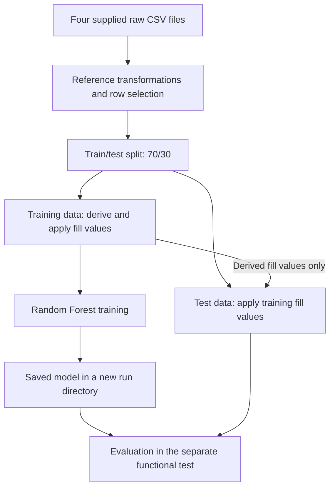
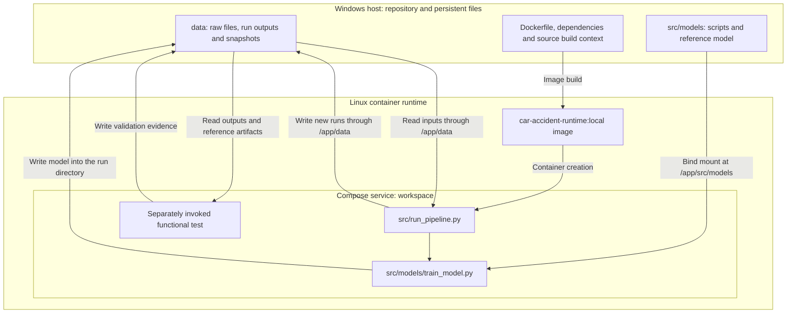
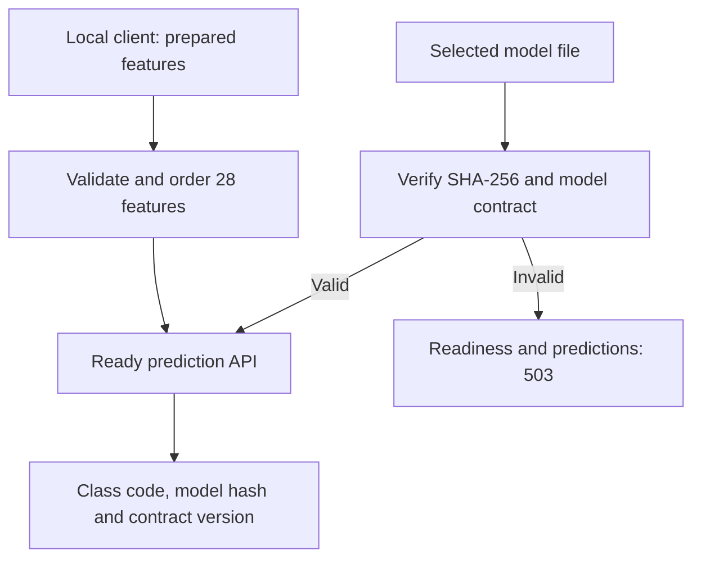
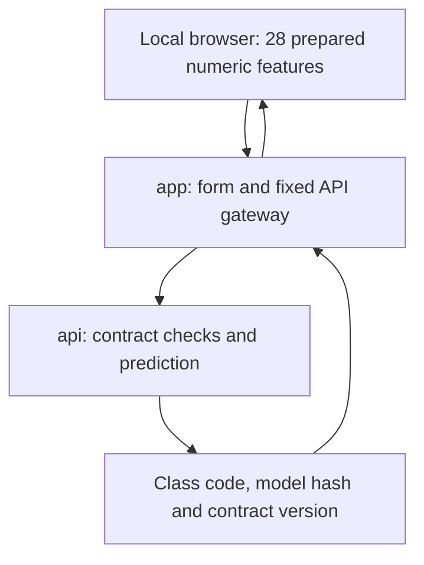
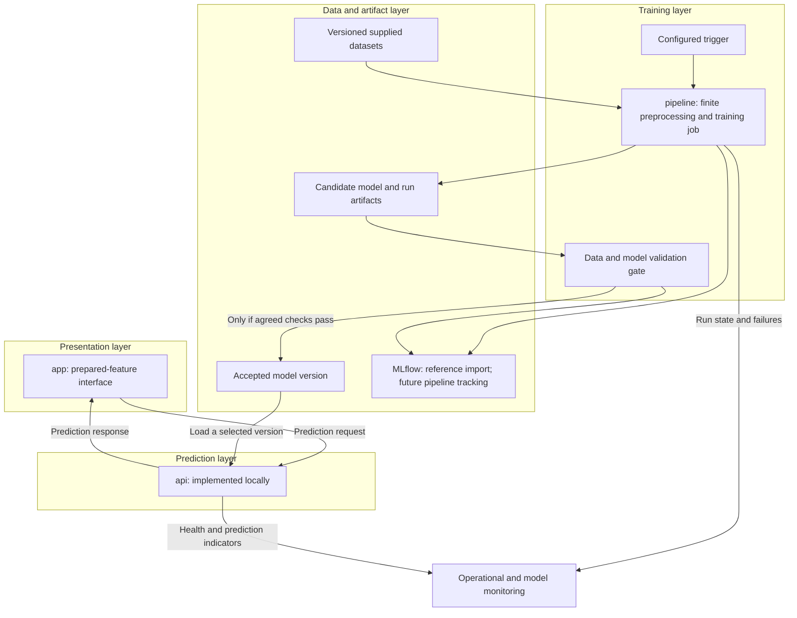

# Architecture

Project: car_accident  
Status: NON_FINAL  
Document date: 2026-10-08  
Implementation evidence: local build and functional validation on 2026-10-03

## Scope and evidence

The project operationalises the supplied 2021 road-accident data,
preprocessing and Random Forest reference model. It is an educational
demonstration, not a validated operational police system.

Docker and Docker Compose are required. Level 1 is mandatory;
Level 2 is a separately tracked extension.

The diagrams distinguish implemented behaviour from the proposed target.
They do not establish deployment approval or a live infrastructure inventory.

Functional validation evidence:
`data/runs/validation_20261003T193310Z_56c49087/validation_report.json`

That report binds the tested source files, raw data and trained model to
SHA-256 hashes and records model metrics. It does not yet provide a complete
link between Git revision, container image identity and model delivery.

## 1. Implemented data flow

- Merging, feature calculations, fixed recoding and selected row filtering
  happen before the split.
- The split uses `test_size=0.3` and `random_state=42`.
- After the split, missing values in `surf`, `circ`, `col` and `motor`
  are filled using modes derived from the training data.
- Training preserves `RandomForestClassifier(n_jobs=-1)`, without a seed.
  Repeated fits can produce different models and predictions.
- Evaluation currently belongs to the separate functional test.
  It is not an automatic pipeline acceptance or delivery gate.

## 2. Implemented runtime boundaries

The evidenced environment uses Windows, WSL2 and Linux containers.
The base `compose.yaml` defines `workspace`. Pipeline commands run in temporary
containers created from that service. The API and application overlays add
separate persistent services, described in sections 3 and 4. The tracking
overlay adds the isolated service described in section 5.

The image contains `src/run_pipeline.py` and `src/data` source files.
Changes to these files require rebuilding the image.

The host directory `src/models` is mounted over the corresponding image
directory. Executed model scripts can therefore differ from the image
contents. The completed functional test compared all three affected
source files with their host hashes.

Both existing bind mounts are writable. The pipeline protects outputs
through new run directories and exclusive file creation; the mounts
themselves do not enforce read-only protection.

### Storage contract

| Location | Purpose |
| --- | --- |
| `data/raw/` | Existing supplied raw CSV files |
| `data/runs/<run_id>/preprocessed/` | Four processed datasets for a new run |
| `data/runs/<run_id>/model/trained_model.joblib` | Newly trained model |
| `data/runs/<run_id>/run_status.json` | Run state and failure information |
| `data/preprocessed/` | Preserved reference datasets |
| `src/models/trained_model.joblib` | Preserved reference model |
| `data/reference_snapshots/20261003T182822Z_3490e1df/` | Preserved reference snapshot |

The pipeline rejects an existing run directory and returns a nonzero exit
code on failure. Failures after run-directory creation are recorded in the
run status when storage remains writable. Failures during initial input
checks occur before a run directory is created.

A completed training run has `approved_for_delivery=false`.

## 3. Local prepared-feature API

Implementation addition: 2026-10-06. Runtime validation must be established
from the installation output, not from the presence of these files.

`compose.api.yaml` adds `api` while keeping `workspace` unchanged. Its image
extends the existing local runtime image. The selected model file is mounted
read-only, and Windows exposes only `127.0.0.1:8000`. The service consumes
prepared features. Raw-input conversion remains separate; the prepared-feature
application is described in section 4.

The service loads the selected artifact once and checks its ordered feature
names, feature count, estimator type and class codes. It neither retrains nor
changes historical delivery approval. Full input rules, artifact identity,
health endpoints, commands and limitations are in [api-contract.md](api-contract.md).
The following target diagram includes this local API; automated delivery and
its acceptance gate are still planned.

## 4. Local prepared-feature application

Implementation addition: 2026-10-07. Establish Windows runtime validation
from the installation output; these files alone do not establish a running app.

`compose.app.yaml` adds `app` and leaves the existing API and workspace files
unchanged. The app image extends the validated local API image and adds no
runtime dependencies. Windows exposes only `127.0.0.1:8080`. The app has no
model, data or repository bind mounts and forwards requests to `api:8000`.

The form can load the preserved reference example. Blank fields are required;
no values or category labels are inferred. Input edits clear the old result,
and the gateway preserves JSON bytes for the API's validation. The interface
displays class codes without unconfirmed severity labels. See
[local-app.md](local-app.md) for use, endpoints, commands and verification scope.

The app's readiness endpoint checks API readiness. This does not constitute
quality approval or continuous monitoring. Raw-input conversion and suitability
for decisions before intervention remain open.

## 5. Local historical reference tracking

Implementation addition: 2026-10-08. Establish Docker/Windows validation from
successful installation output; source presence alone does not establish it.

`compose.tracking.yaml` adds `mlflow` and a temporary `tracking-import` tool.
The isolated tracking image pins MLflow 3.17.0. Windows publishes only
`127.0.0.1:5000`. The server persists SQLite metadata and artifact copies in
`data/tracking/`; the tool reads the selected October 3 reference directory
through a read-only mount and transfers files through the artifact proxy.

The first run imports the unchanged validation report, run status and selected
model bytes. It retains original timestamps, observed metrics, class-code
mapping and `approved_for_delivery=false`. The original training Git revision
and image identity remain unknown. Import Git baseline, dirty worktree state,
image identity, importer hash and time are recorded separately.

A sequential repeat verifies the same finished run and its artifact hashes.
This does not instrument subsequent pipeline runs, register a model version,
change the API model, enforce acceptance thresholds or retrain. Detailed storage,
provenance, commands and test scope are in [tracking.md](tracking.md).

## 6. Target architecture and remaining work

This diagram describes the target integration. The local API and prepared-feature
application have separate implementations. A dedicated pipeline service,
automated accepted-model delivery, future pipeline tracking and full monitoring
remain planned. Local historical reference tracking is now implemented separately.
Logical layers do not imply one microservice for every pipeline stage.

### Service responsibilities and transition

| Component | Responsibility and lifecycle |
| --- | --- |
| `workspace` | Current development and test environment; may remain optional after responsibilities are covered |
| `pipeline` | Proposed finite job for preprocessing and training; independent of prediction requests |
| `api` | Implemented local prepared-feature service with an explicit model hash |
| `app` | Separate local prepared-feature form and gateway to the API |
| `mlflow` and storage | Local reference metadata and byte-identical artifact copies; future pipeline integration remains planned |
| Monitoring | Track failures, service health and agreed data/model indicators |

The local API, prepared-feature application and historical reference tracking
are now included. Add data/model versioning, future pipeline tracking, configured
triggers and controlled delivery in subsequent work. A complete raw-input
application remains a separate task.

MLflow is selected for this local tracking step. DVC remains a candidate for
a separate data/model versioning step; it is not installed or configured here.

The prepared-feature contract is specified in `docs/api-contract.md`. Mapping
raw application inputs to the model's 28 ordered features remains separate;
the supplied example does not establish a complete raw-input serving pipeline.

## 7. Limitations and open decisions

- The inherited successive target recodings map original codes
  `[1, 2, 3, 4]` to `[1, 1, 1, 0]`. Domain labels remain unconfirmed.
- Selection of one road-user row per accident depends on observed severity.
  This limits claims about prediction before intervention.
- The measured model metrics are reference observations, not agreed
  quality thresholds. Agree thresholds before enforcing model acceptance.
- No configured recurring trigger, raw-input application, model registry
  or complete monitoring workflow is evidenced. The API and prepared-feature
  app expose local liveness and readiness; these do not establish quality approval.
- Labelled predictive performance and unlabelled drift indicators must
  remain distinct.
- Direct runtime dependencies are pinned; full dependency and base-image
  locking remain open.
- Access controls, deployment destination and recovery policy remain open.
- Level 1 acceptance is incomplete. Level 2 build/test/deployment automation
  remains a separate extension target.

## Maintenance

Update the relevant diagram when component responsibilities, data paths
or runtime boundaries change. Record the evidence date when changing an
implementation claim. Version this document with the corresponding code;
planned components must remain visibly identified until implemented.
